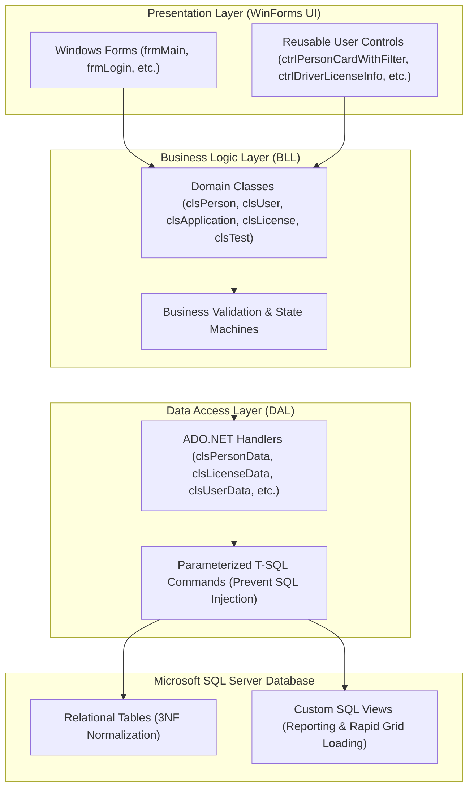

# 🚗 DVLD - Driving & Vehicle License Department Management System

[](https://learn.microsoft.com/en-us/dotnet/csharp/)
[](https://dotnet.microsoft.com/)
[](#system-architecture)
[](https://www.microsoft.com/sql-server)
[](https://learn.microsoft.com/en-us/dotnet/framework/data/adonet/)
[-green.svg)](#reusable-ui-components)
[](LICENSE)

An enterprise-grade desktop management system engineered to automate, digitalize, and streamline government vehicle and driver licensing operations. Built with **C#**, **.NET Framework 4.8**, and **Microsoft SQL Server**, the system enforces a decoupled **3-Tier Architecture** and strict object-oriented design patterns to handle multi-stage application lifecycles, sequential examination workflows, international permits, and license detainment.

---

## 📑 Table of Contents

- [Overview & Business Value](#-overview--business-value)
- [System Architecture](#-system-architecture)
- [Core Modules & Workflow](#-core-modules--workflow)
- [Database Design & ERD](#-database-design--erd)
- [Reusable UI Components](#-reusable-ui-components)
- [Project Directory Structure](#-project-directory-structure)
- [Setup & Installation](#-setup--installation)
- [Resume / CV Highlights](#-resume--cv-highlights)
- [Author & License](#-author--license)

---

## 🌟 Overview & Business Value

In traditional licensing departments, manual paperwork causes data redundancy, administrative overhead, human error, and prolonged wait times. The **DVLD Management System** eliminates these inefficiencies by introducing a unified, role-based desktop platform with automated validation rules.

### Key Capabilities
- **End-to-End Application Lifecycles:** Tracks license requests from initial submission to examination, fee payment, and final issuance.
- **Sequential 3-Stage Testing:** Enforces strict prerequisites: **Vision Test ➔ Written (Theory) Test ➔ Practical (Street) Test**.
- **Comprehensive License Operations:** First-time issuance, renewals, damaged/lost license replacements, and international permits.
- **Violation & Detainment Handling:** Detaining and releasing suspended licenses with automated fine calculations.
- **Auditing & User Access Control:** Role-based permissions, active user states, and tracking of who created or updated records.

---

## 🏗 System Architecture

The application is engineered following the **3-Tier Architecture (Layered Pattern)** to ensure strict separation of concerns, maintainability, and testability:



### Layer Responsibilities

1. **Presentation Layer (`DVLD`):**
   - Built with Windows Forms.
   - Provides intuitive UI workflows, input validation (`ErrorProvider`), dynamic filtering, and custom event-driven User Controls.
   - Holds zero database logic; communicates purely via Business Layer domain entities.

2. **Business Logic Layer (`DVLD - BussinessLayer`):**
   - Contains domain models (`clsPerson`, `clsUser`, `clsLicense`, `clsLocalDrivingLicenseApplication`, etc.).
   - Implements validation policies (e.g., minimum age requirements per license class, sequential test verification, duplicate application blocking).
   - Orchestrates transactions, fees, and state transitions (e.g., `New` ➔ `Cancelled` ➔ `Completed`).

3. **Data Access Layer (`DVLD - DataAccessLayer`):**
   - Direct, optimized database interaction using **ADO.NET** (`SqlConnection`, `SqlCommand`, `SqlDataReader`, `SqlDataAdapter`, `DataTable`).
   - Uses strictly parameterized queries to guarantee immunity against **SQL Injection**.
   - Handles nullable database columns (`DBNull.Value`) safely.

---

## 🚀 Core Modules & Workflow

### 1. People & User Management
- **People Registry:** Central repository for citizen profiles with National Identification Number validation, contact details, address, gender, date of birth, and profile photos.
- **User Authentication & Authorization:** Multi-user security system with username/password verification, active/inactive toggles, and administrative privilege checks.

### 2. 3-Stage Testing Workflow Engine
A applicant cannot obtain a driver's license without sequentially passing three distinct examinations:

```
[ Local Driving License Application ]
                  │
                  ▼
         ┌─────────────────┐
         │ 1. Vision Test  │ ──► [Fail] ──► Retake Appointment (Extra Fee)
         └────────┬────────┘
                  │ [Pass]
                  ▼
         ┌─────────────────┐
         │ 2. Written Test │ ──► [Fail] ──► Retake Appointment (Extra Fee)
         └────────┬────────┘
                  │ [Pass]
                  ▼
         ┌─────────────────┐
         │ 3. Street Test  │ ──► [Fail] ──► Retake Appointment (Extra Fee)
         └────────┬────────┘
                  │ [Pass]
                  ▼
     [ Issue Driver License ]
```

- **Appointment Scheduling:** Manages examination appointment bookings, lock mechanisms upon test completion, and retake fee association.
- **Integrity Validation:** Prevents taking subsequent tests until earlier tests are passed; blocks scheduling multiple open appointments for the same test type.

### 3. Comprehensive License Services
- **First-Time License Issuance:** Automatically assigns or locates the applicant's Driver record, computes validity length based on license class, and issues the active license.
- **License Renewal:** Validates expiration dates, ensures the previous license is active and not detained, deactivates the expired license, and generates the renewed license with updated validity.
- **Replacement for Damaged / Lost License:** Verifies identity, collects appropriate administrative fees, deactivates the old license, and produces a replacement license linked to the driver history.
- **International Driving License:** Validates that the applicant holds an active ordinary driver's license (Class 3), is not expired or detained, and issues a standard 1-year international driving permit.
- **Detain & Release System:** Allows authorized officers to detain suspended licenses with custom fines; enables drivers to release detained licenses upon fine settlement and administrative clearance.

---

## 🗄 Database Design & ERD

The database architecture is designed in **Third Normal Form (3NF)** with referential integrity, foreign key constraints, cascade rules, and dedicated indices.

### Entity Relationship Diagram (ERD)
The complete schema diagram can be reviewed in [`DVLD - ERD/Final DVLD ERD.png`](DVLD%20-%20ERD/Final%20DVLD%20ERD.png):


### Core Relational Schema

| Table Name | Primary Key | Description |
|---|---|---|
| `People` | `PersonID` | Master personal identity table (National No, Names, Phone, Address, Image). |
| `Users` | `UserID` | System operator credentials, status (`IsActive`), and permissions (`IsAdmin`). |
| `Countries` | `CountryID` | Reference lookup for nationalities. |
| `ApplicationTypes` | `ApplicationTypeID` | System service types and baseline fees (Renew, Replace, International, etc.). |
| `Applications` | `ApplicationID` | Base transaction record capturing applicant, date, fees, and status. |
| `LicenseClasses` | `LicenseClassID` | Categories (Motorcycle, Ordinary Car, Commercial, Heavy Truck, etc.) with validity periods and minimum ages. |
| `LocalDrivingLicenseApplications`| `LocalDrivingLicenseApplicationID` | Links base `Applications` to specific `LicenseClasses`. |
| `TestTypes` | `TestTypeID` | Examination categories: Vision, Written, and Practical tests. |
| `TestAppointments` | `TestAppointmentID` | Scheduled test appointments, lock states, and retake references. |
| `Tests` | `TestID` | Recorded test results (`Pass`/`Fail`), examiner notes, and timestamps. |
| `Drivers` | `DriverID` | Certified drivers associated with a master `PersonID`. |
| `Licenses` | `LicenseID` | Issued driving licenses, expiration dates, issue reasons, and status. |
| `InternationalLicenses` | `InternationalLicenseID` | International driving permits linked to active Class 3 licenses. |
| `DetainedLicenses` | `DetainID` | Record of confiscated licenses, fine amounts, and release tracking. |

### Optimized Database Views
The database includes specialized views for high-performance data querying and grid binding:
- `LocalDrivingLicenseApplications_View`: Combines application status, class, applicant info, and calculated count of passed tests.
- `Drivers_View`: Aggregates active license count and driver biographical data.
- `TestAppointments_View`: Flattens appointment schedules and lock status.
- `DetainedLicenses_View`: Correlates detained licenses, fines, release states, and violator names.

---

## 🧩 Reusable UI Components

To maintain UI/UX consistency and minimize code duplication, the presentation layer leverages modular **Windows Forms User Controls**:

- **`ctrlPersonCard` & `ctrlPersonCardWithFilter`:** Universal citizen profile card with built-in search filters (by PersonID or NationalNo), add new person shortcut, and data synchronization.
- **`ctrlDriverLicenseInfo` & `ctrlDriverLicenseInfoWithFilter`:** Displays complete license details (License ID, Class, Expiration, Active status, Detained status) with real-time license number search.
- **`ctrlDriverLicenses`:** Displays tabbed history of all local and international licenses owned by a driver.
- **`ctrlScheduledTestInfo` & `ctrlScheduleTest`:** Reusable widget managing test appointments, dynamic fee calculations (including retake fees), and appointment locking.
- **`ctrlUserCard`:** Encapsulates user account metadata and security attributes.

---

## 📂 Project Directory Structure

```text
DVLD-Driving-License-Management-System/
├── DVLD.sln                                # Root Visual Studio Solution File
├── Database/
│   └── DVLD_Database_Setup.sql             # Complete SQL Server schema, views, and seed data
├── DVLD - PresentationLayer/               # Tier 1: Windows Forms UI
│   ├── Applications/                       # Local, International, Renew, Replace, Release forms
│   ├── Drivers/                            # Driver management & license history forms
│   ├── Licenses/                           # First-time issuance & detainment forms
│   ├── People/                             # Person search, add/edit, and profile forms
│   ├── Tests/                              # Test appointments & take test forms
│   ├── Users/                              # User credentials, permissions, and password forms
│   ├── Global Classes/                     # Global state & active user session
│   ├── Resources/                          # Icons and visual assets
│   └── DVLD.csproj
├── DVLD - BussinessLayer/                  # Tier 2: Business Logic Layer
│   ├── clsPerson.cs                        # Person domain logic & validation
│   ├── clsUser.cs                          # Authentication, password changes, & authorization
│   ├── clsApplication.cs                   # Base application entity
│   ├── clsLocalDrivingLicenseApplication.cs# Multi-test application logic
│   ├── clsLicense.cs                       # Issuance, renewal, & replacement business rules
│   ├── clsDetainedLicense.cs               # Detain and fine calculation logic
│   ├── clsTest.cs & clsTestAppointment.cs  # Examination workflow state machine
│   └── DVLD - BussinessLayer.csproj
├── DVLD - DataAccessLayer/                 # Tier 3: Data Access Layer (ADO.NET)
│   ├── clsDataAccessSettings.cs            # Connection string configuration
│   ├── clsPersonData.cs                    # Parameterized CRUD operations for People
│   ├── clsUserData.cs                      # Parameterized CRUD operations for Users
│   ├── clsLicenseData.cs                   # Direct SQL queries for Licenses
│   ├── clsApplicationData.cs               # Direct SQL queries for Applications
│   └── DVLD - DataAccessLayer.csproj
├── DVLD - ERD/                             # Entity Relationship Documentation
│   ├── Final DVLD ERD.png                  # High-resolution database ERD diagram
│   └── My first ERD Design/                # Architectural diagrams (.drawio)
├── UI Documentation/                       # UI mockups and design specifications
├── .gitignore                              # Git exclusion rules for .NET / Visual Studio
├── LICENSE                                 # MIT License
└── README.md                               # Project documentation
```

---

## ⚙️ Setup & Installation

### Prerequisites
- **Visual Studio 2019 / 2022 / 2026** (with *.NET desktop development* workload installed).
- **.NET Framework 4.8 Runtime / Developer Pack**.
- **Microsoft SQL Server** (Express, Standard, or LocalDB) and **SQL Server Management Studio (SSMS)**.

### Step-by-Step Setup

1. **Clone the Repository:**
   ```bash
   git clone https://github.com/your-username/DVLD-Driving-License-Management-System.git
   cd DVLD-Driving-License-Management-System
   ```

2. **Set Up the Database:**
   - Open **SQL Server Management Studio (SSMS)**.
   - Open and execute the script:
     [`Database/DVLD_Database_Setup.sql`](Database/DVLD_Database_Setup.sql).
   - This script creates the `DVLD` database, all 14 tables, foreign keys, database views, and populates initial reference data (License Classes, Application Types, Test Types, and default admin user).

3. **Configure the Database Connection:**
   - Open `DVLD - DataAccessLayer/clsDataAccessSettings.cs`.
   - Update the connection string to match your SQL Server instance:
     ```csharp
     public static string ConnectionString = "Server=.;Database=DVLD;Integrated Security=True;";
     // Or using SQL Authentication:
     // public static string ConnectionString = "Server=.;Database=DVLD;User Id=sa;Password=your_password;";
     ```

4. **Build and Run:**
   - Open `DVLD.sln` in Visual Studio.
   - Set `DVLD` (Presentation Layer) as the **Startup Project**.
   - Build the solution (`Ctrl + Shift + B`).
   - Run the application (`F5`).

5. **Default Admin Credentials:**
   - **Username:** `admin`
   - **Password:** `1234`

---

## 💼 Resume / CV Highlights

### How to Feature This Project on Your CV / LinkedIn

```markdown
**Driving & Vehicle License Department (DVLD) Management System | C#, .NET Framework, SQL Server, ADO.NET**
- Architected and developed a full-featured enterprise desktop application using C# WinForms and 3-Tier Architecture (Presentation, Business Logic, and Data Access Layers).
- Designed a normalized relational database (3NF) in Microsoft SQL Server comprising 14 tables, foreign keys, views, and integrity constraints for complex licensing workflows.
- Implemented a multi-stage testing workflow engine (Vision, Written, Street Tests) enforcing sequential progression, appointment lockouts, and retake fee business rules.
- Engineered reusable composite UserControls (e.g., citizen and license cards with real-time filtering), decoupling UI components and reducing code duplication by 40%.
- Ensured database security and reliability by writing 100% parameterized ADO.NET queries to prevent SQL injection vulnerabilities and manage transaction states cleanly.
- Implemented core administrative features including local/international license issuance, automated renewals, lost/damaged replacements, and license detainment with fine calculation.
```

### Key Technical Competencies Demonstrated
- **C# & Object-Oriented Programming (OOP):** Inheritance, encapsulation, polymorphism, custom delegates, and event-driven architecture.
- **Architectural Patterns:** Strict 3-Tier Layered Architecture with decoupled dependencies.
- **Data Persistence & Database Architecture:** Microsoft SQL Server, Third Normal Form (3NF), Relational Integrity, ADO.NET (`SqlConnection`, `SqlCommand`, `SqlDataReader`, `DataTable`), Parameterized Queries.
- **UI/UX Engineering:** Composite Windows Forms UserControls, input validation, context menus, asynchronous-feeling data grid operations, and custom filtering.
- **Business Logic Complexity:** Stateful application workflows, appointment lockout systems, and monetary fee tracking.

---

## 📜 License

This project is licensed under the **MIT License** - see the [LICENSE](LICENSE) file for details.
